[](https://jagdish3135.github.io/knit/)

<picture>
  <source media="(prefers-color-scheme: dark)" srcset="docs/readme/banner-dark.svg">
  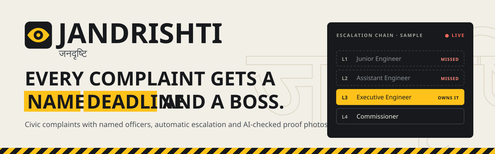
</picture>

<p align="center">
  <a href="https://jandrishti-app.vercel.app"><b>Live demo</b></a> ·
  <a href="#try-it-in-60-seconds">Try it in 60 seconds</a> ·
  <a href="#how-it-works">How it works</a> ·
  <a href="#run-it-locally">Run locally</a>
</p>

<p align="center">
  
  
  
  
  
  
  
  
</p>

**JanDrishti** (जनदृष्टि, "the people's eye") is one dashboard for complaints about any government service:
roads, water, drainage, street lights, garbage, parks and trees, public health and encroachment, in **English, हिन्दी and मराठी**. Every complaint gets a **named officer** and a **visible deadline**.
Miss the deadline and it **moves up to that officer's senior automatically**. It only closes with a **live, on-site
photo that hasn't been used before**, and every officer has a public score built from their actual work.

## Made for every citizen

Designed so a first-time smartphone user in their seventies can report a problem without help:

- **Three languages:** English, हिन्दी and मराठी, switched at the top of every page. Departments, problem types, wards, job titles, dates and durations are all translated.
- **A− A A+ text size** at the top of every page (remembered), 17 px body text by default, 48 px buttons.
- **Plain words:** "Report a problem", "Must be fixed by Tue, 28 Oct · 3 days left", "Moved to senior officer". No jargon, no ticking seconds.
- **Track by number** right on the home page, and a **parcel-style progress tracker** on every complaint.
- **High contrast** blue and white (every text colour measured at 4.5:1 or more), a strong yellow keyboard focus ring, and a light/dark switch.
- **Reporting in three steps:** pick the department from a dropdown, then the problem type, or **"Other problem"** and describe it in a few words. Then mark the place and add details.
- Big department tiles, a light blue-and-white look, and a "Common questions" section.

## See it work

**A missed deadline climbs the chain.** Priya's pothole goes from the Junior Engineer to the Assistant Engineer,
then the Executive Engineer, then the Commissioner, each time its deadline passes. The demo clock fast-forwards time.

<p align="center">
  <a href="docs/readme/escalation.mp4">
    <picture>
      <source srcset="docs/readme/escalation.webp" type="image/webp">
      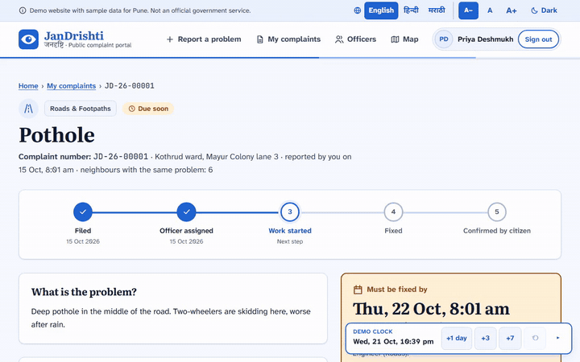
    </picture>
  </a>
</p>

**Old photos don't close cases.** The officer tries last month's proof photo and it's caught by its fingerprint and
logged on their record. A live photo taken on site passes every check and closes the case.

<p align="center">
  <a href="docs/readme/proof.mp4">
    <picture>
      <source srcset="docs/readme/proof.webp" type="image/webp">
      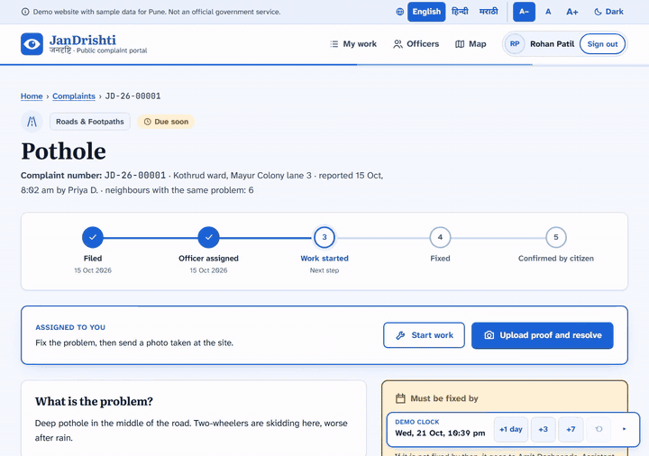
    </picture>
  </a>
</p>

<sub>MP4 versions: <a href="docs/readme/escalation.mp4">escalation.mp4</a> · <a href="docs/readme/proof.mp4">proof.mp4</a></sub>

## How it works

<picture>
  <source media="(prefers-color-scheme: dark)" srcset="docs/readme/how-it-works-dark.svg">
  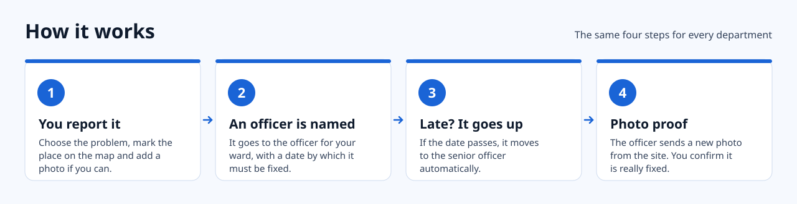
</picture>

| | What happens | Where it lives |
|---|---|---|
| **File** | Choose one of 8 departments, then one of 18 problem types or "Other problem" (with a short description). Drop a pin and add a photo. The pin picks the ward; the department picks the officer chain. | [`FileComplaint.tsx`](src/pages/FileComplaint.tsx), [`catalog.ts`](src/lib/catalog.ts) |
| **Languages** | Every interface string exists in English, Hindi and Marathi; a test fails if one is missing or loses a placeholder. | [`i18n.tsx`](src/lib/i18n.tsx), [`i18n-hi.ts`](src/lib/i18n-hi.ts), [`i18n-mr.ts`](src/lib/i18n-mr.ts) |
| **Duplicates** | Same type, still open, within 150 m? You're offered "support this instead". Supporters raise priority. | [`duplicates.ts`](src/lib/duplicates.ts) |
| **Deadlines** | Each type has a fixed time limit (1 to 10 days), in the spirit of Maharashtra's Right to Public Services Act. | [`catalog.ts`](src/lib/catalog.ts) |
| **Escalation** | Deadline passed → the senior officer gets it with half the original time. Repeats up to the Commissioner. Each step counts against the officer who missed it. | [`sla.ts`](src/lib/sla.ts) |
| **Proof checks** | Live camera capture · within 150 m of the site · taken after filing · 64-bit image fingerprint (dHash) matches no earlier proof photo. Failed attempts are logged. | [`proof.ts`](src/lib/proof.ts), [`dhash.ts`](src/lib/dhash.ts) |
| **Scores** | 40% fixed on time · 20% proof passed first time · 25% citizen ratings · 15% free of escalations and reopened cases. Only the citizen who filed can rate, once, per case. | [`scoring.ts`](src/lib/scoring.ts) |
| **Sign-in** | Mobile OTP, then an Aadhaar format check (12 digits + Verhoeff checksum). Only the last 4 digits are kept. | [`verhoeff.ts`](src/lib/verhoeff.ts) |

## Screenshots

<table>
  <tr>
    <td width="50%">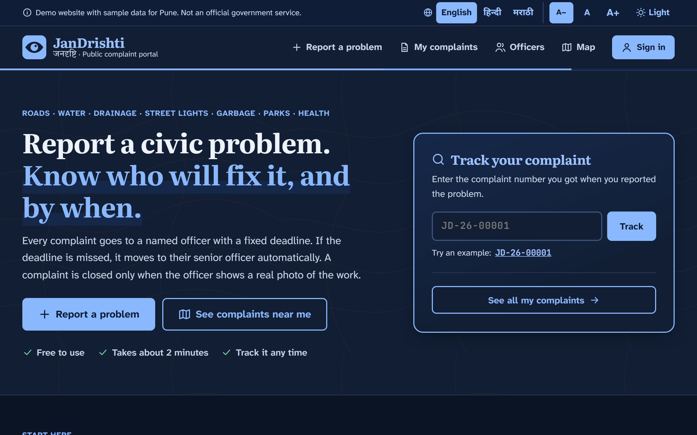</td>
    <td width="50%">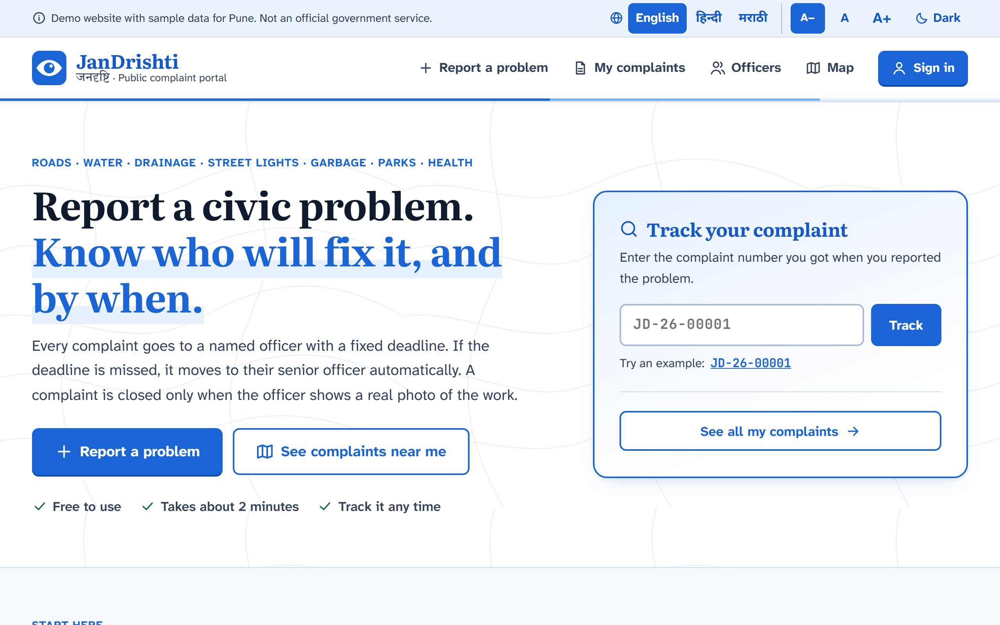</td>
  </tr>
  <tr>
    <td>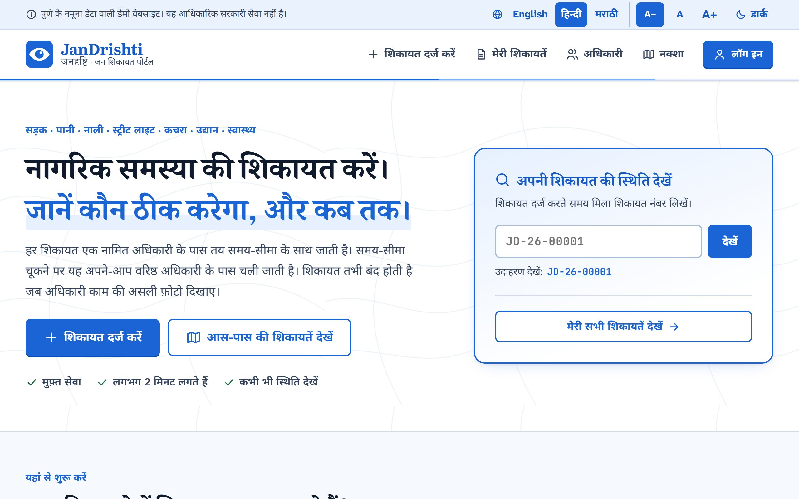<br><sub><b>हिन्दी:</b> the whole site switches language from the top bar.</sub></td>
    <td>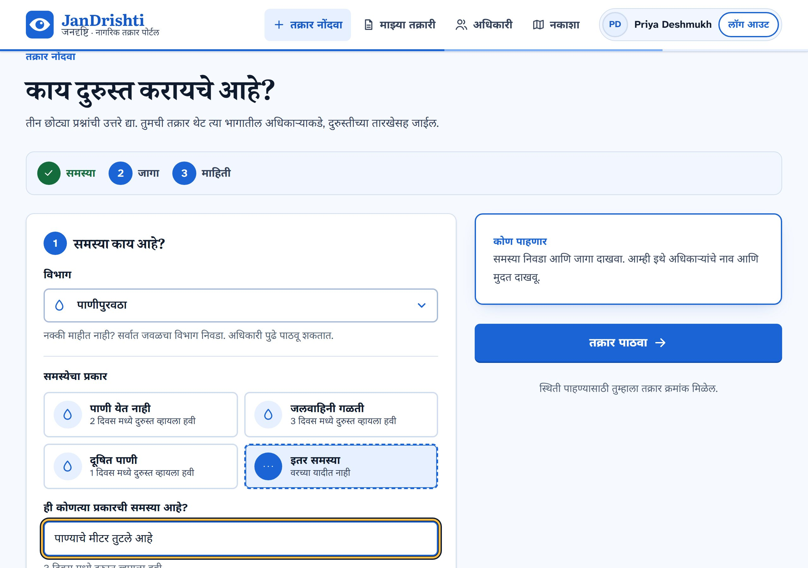<br><sub><b>मराठी:</b> department dropdown, problem types and "Other problem".</sub></td>
  </tr>
  <tr>
    <td>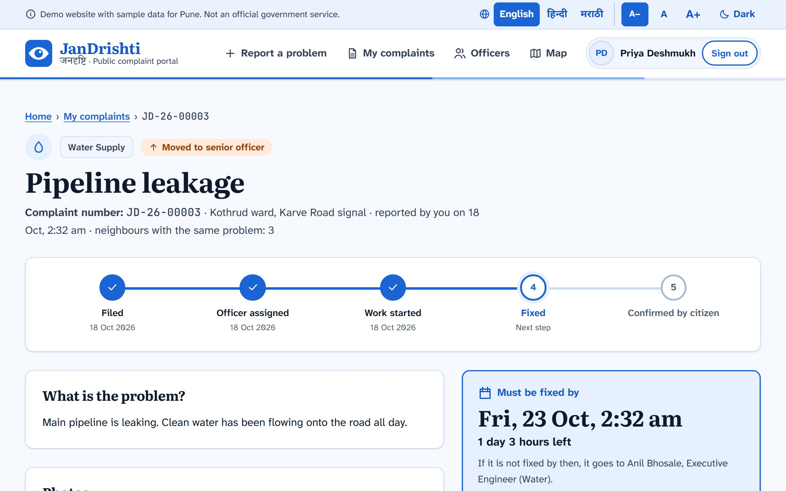<br><sub><b>Complaint:</b> progress tracker, deadline in plain words, who has it now and who's next.</sub></td>
    <td>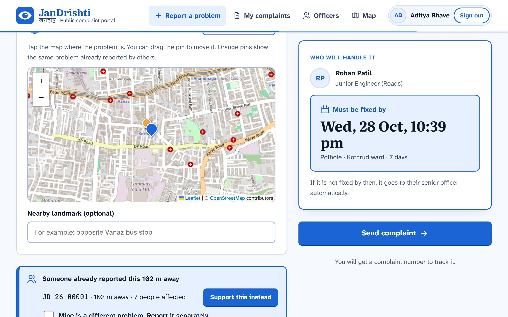<br><sub><b>Reporting:</b> who will handle it, the deadline, and a duplicate 133 m away.</sub></td>
  </tr>
  <tr>
    <td>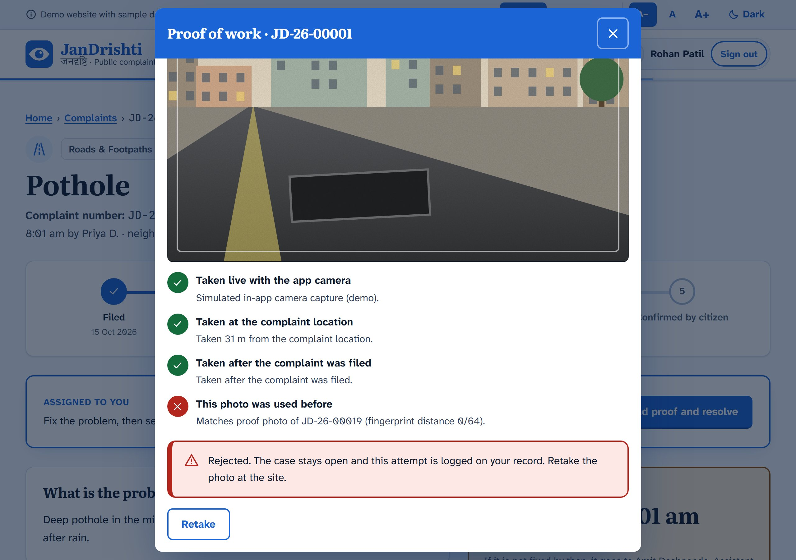<br><sub><b>Proof:</b> a reused photo is caught (distance 0/64).</sub></td>
    <td>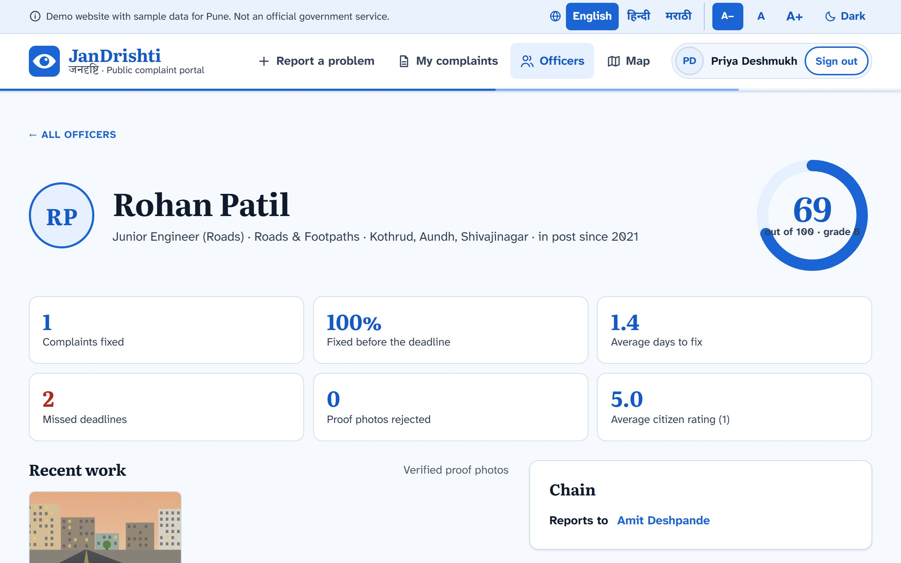<br><sub><b>Officer profile:</b> score, record and verified work.</sub></td>
  </tr>
  <tr>
    <td>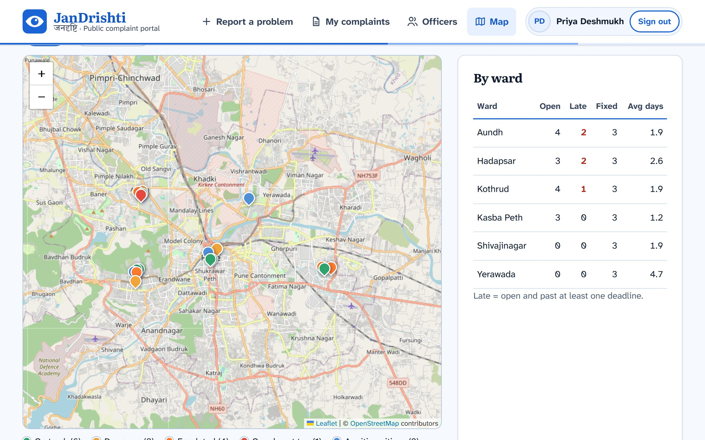<br><sub><b>Map:</b> every complaint by status, with a ward table.</sub></td>
    <td>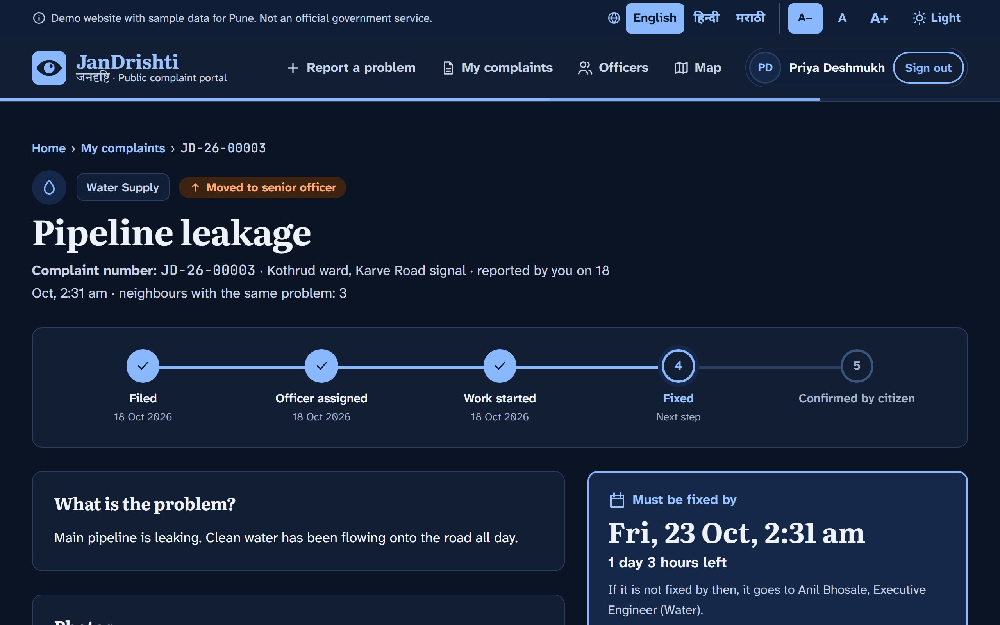<br><sub>Dark mode, one tap away in the top bar.</sub></td>
  </tr>
</table>

<p align="center">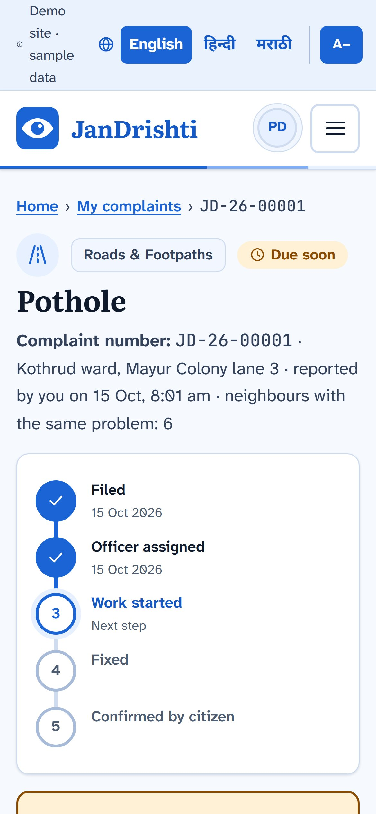</p>

## Try it in 60 seconds

1. Open the [live demo](https://jandrishti-app.vercel.app), or type **JD-26-00001** in "Track your complaint".
2. Press **Sign in → Continue as Priya Deshmukh** and open her **Pothole** complaint (due soon). Press **+1 day** on the demo clock at the bottom right and watch it move to the senior officer.
3. **Sign out**, sign in as **Officer → Amit Deshpande** (or whoever owns it now) and press **Upload proof and resolve**.
4. Try **"cheat with an old proof photo"** (rejected), then **"simulate a live photo on site"** (passes).
5. Back as Priya: confirm the fix and rate it. The officer's score updates on **Officers**.

Or file your own: tap anywhere in the six Pune wards on the map. **Reset demo data** is in the footer.

<details>
<summary><b>What's real and what's a demo</b></summary>

- **Real:** the escalation engine, deadlines, duplicate detection, photo fingerprinting, GPS and time checks,
  scoring, the Aadhaar checksum, the map. All of it runs and is unit-tested.
- **Demo:** officers, wards and complaints are fictional sample data for Pune. Data is stored in your browser
  (`localStorage`), so it isn't shared between devices. The OTP is shown on screen instead of sent by SMS.
- **Aadhaar:** real Aadhaar authentication needs approval from UIDAI. The prototype only checks the number's format
  and keeps the last 4 digits; a live system would verify through UIDAI or DigiLocker.
- **Camera:** in a browser, "live capture" means the in-app camera (`getUserMedia`). Gallery uploads are accepted
  but fail the live check. Because you're probably not standing in Pune, the proof dialog has clearly labelled demo shortcuts.
- **Languages:** the interface is fully translated; what citizens type (descriptions, landmarks) and officer names stay as written.
- **Later:** voice complaints in Marathi and Hindi, an AI before/after comparison, real DigiLocker sign-in, SMS and WhatsApp alerts.
  See [IDEA.md](IDEA.md).

</details>

<details>
<summary><b>Project layout</b></summary>

```
src/
  lib/           pure logic (unit-tested): sla, scoring, dhash, proof, duplicates, geo, verhoeff,
                 catalog (wards, departments, officers), seed (sample data), scenes (sample photos), store
  components/    layout, map, proof dialog, shared bits
  pages/         landing, login, file, my complaints, complaint, officer desk, officers, officer profile, map
docs/readme/     README media and the scripts that make it (capture.mjs, make-svgs.mjs)
design-archive/  the first design (v1, "civic signal") as one self-contained HTML file
```

</details>

## Run it locally

```bash
npm install
npm run dev        # http://127.0.0.1:5180
npm test           # 31 unit tests (vitest)
npm run lint
npm run build      # static site in dist/
npm run snapshot   # the whole app as one HTML file that opens from disk (dist-snapshot/)
```

Regenerate the README media (needs `ffmpeg`): `npm run build && npm run preview`, then
`node docs/readme/capture.mjs shots,video http://127.0.0.1:5181` and `node docs/readme/make-svgs.mjs`.

## Deploy

It's a static site. On Vercel, import the repo with the default Vite settings; [`vercel.json`](vercel.json) sends
every route to `index.html`. No environment variables or database needed.

---

<sub>A prototype with fictional data. Not a government service. Map data © OpenStreetMap contributors.</sub>
